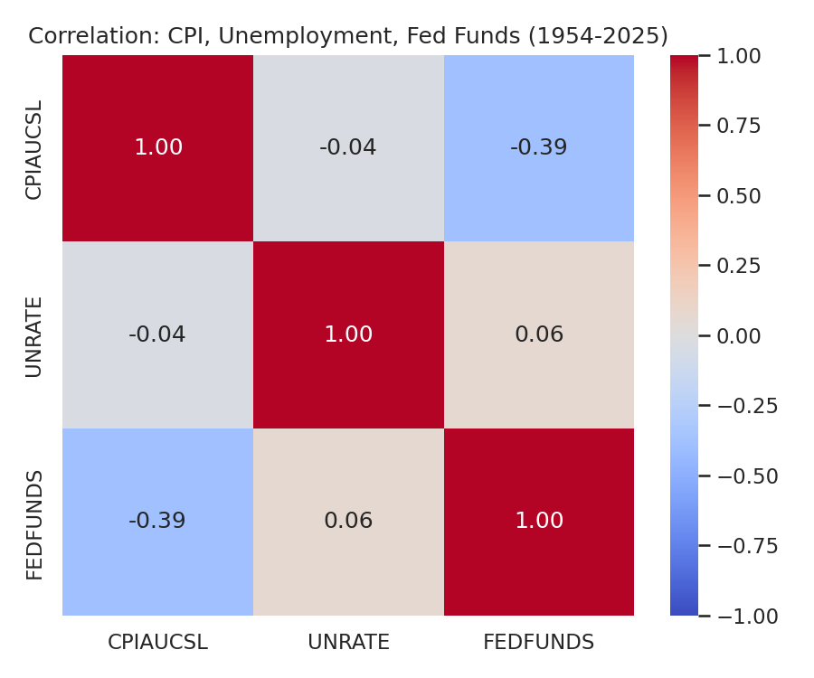
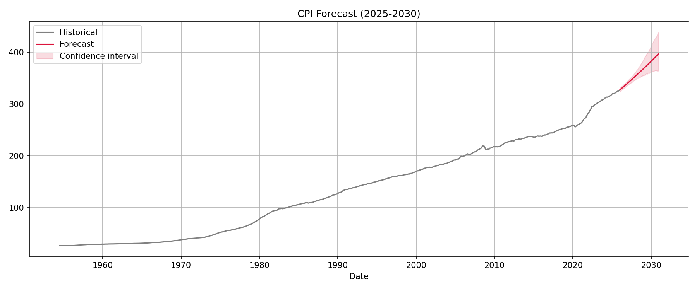

# Market & Economic Analytics

**70 years of U.S. macro data, meets 5-year forecasts — and an honest account of where those forecasts break down.**

A full data science pipeline on U.S. inflation, unemployment, interest rates, and the stock market: raw [FRED](https://fred.stlouisfed.org/) data → cleaning → exploratory analysis → time-series forecasting with [Prophet](https://facebook.github.io/prophet/).

`Python` `pandas` `Prophet` `scikit-learn` `matplotlib/seaborn` `Jupyter`

---

## TL;DR

- Merged 4 FRED series (CPI, unemployment, Fed Funds, S&P 500) into two purpose-built datasets — one spanning **1954–2025**, one **2021–2025** — after discovering a naive merge was silently discarding 70 years of history (see [Data](#data)).
- Forecast each series 5 years out with Prophet, using a modeling choice fitted to what each series actually *is*: exponential growth (CPI, log-transformed), bounded/cyclical (Fed Funds, logistic growth), and a short, low-confidence window (S&P 500) — not one model applied blindly to all three.
- Caught and fixed three real forecasting bugs along the way: a boundary discontinuity where the fitted trend didn't reach the last actual observation, an evaluation method that understated real error, and a runaway Fed Funds forecast that climbed while actual rates were falling.
- Every number in this README is generated by the notebooks, not hand-typed — `reports/model_accuracy.txt` is written by the code, not edited after the fact.

## What's in here

```
Data/raw/         Original FRED CSV exports
Data/processed/    Cleaned datasets + 5-year forecasts
notebook/           01 data loading & cleaning · 02 EDA · 03 predictive modelling
models/             Saved Prophet models (.pkl)
reports/             Accuracy report + correlation tables
visuals/             Exported charts (PNG)
```

## Data

| Series | What it is | History available |
|---|---|---|
| `CPIAUCSL` | Consumer Price Index (inflation) | 1947 – present |
| `UNRATE` | Unemployment rate | 1948 – present |
| `FEDFUNDS` | Federal Funds effective rate | 1954 – present |
| `SP500` | S&P 500 index level (daily) | **~2021 – present only** |

FRED's `SP500` series is licensed from S&P and only keeps a rolling ~5-year window — not a choice, a hard constraint. A naive join on all four series would silently truncate 70 years of macro history down to 5. Instead, this project builds **two** datasets:

- `macro_long_history.csv` — CPI, unemployment, Fed Funds, back to **1954** (857 months)
- `master_monthly_dataset.csv` — all four series together, **2021–2025** (58 months)

Trend analysis and the CPI/Fed Funds forecasts run on the long-history dataset; anything touching SP500 is working with a much shorter window, flagged everywhere it matters.

## Key findings


- **CPI and the Fed Funds rate move together over 1954–2025** — consistent with the Fed raising rates to fight inflation, exactly what played out in 2022–2023.
- **Unemployment is negatively correlated with Fed Funds** over the long run, in line with tighter policy cooling the labor market.
- **2021–2025 shows SP500 strongly correlated with CPI and Fed Funds** — but that's one economic cycle, not a stable structural relationship (see [Limitations](#limitations)).

<details>
<summary>Full correlation matrices</summary>




</details>

## Forecasting methodology

Each series got a model fitted to its actual behavior, not a one-size-fits-all default — and every model was evaluated on a holdout **matched to the 5-year forecast horizon**, not an arbitrary 80/20 split (which on 70 years of data would test 14-years-ahead accuracy and understate real error).

| Series | Approach | Why |
|---|---|---|
| CPI | Linear trend on **log(CPI)**, full 1954–2025 history | A price index grows ~exponentially; a linear trend on raw CPI underfits recent acceleration |
| Fed Funds | **Logistic (bounded) growth**, capped 0–12%, full history | A policy rate is mean-reverting and cyclical, not a growth trend — bounding it prevents runaway extrapolation |
| S&P 500 | Linear trend on log(SP500), 2021–2025 only | Best available given the data limitation above |

**Accuracy** *(live-generated — see `reports/model_accuracy.txt`)*:

| Series | MAE | RMSE | Why it's this high |
|---|---|---|---|
| CPI | ~25 | ~27 | Holdout spans the 2021–23 inflation shock — a structural break no pre-2021 model could see coming |
| Fed Funds | ~3.0 | ~3.5 | Holdout spans the 2022–23 hiking cycle from near-zero |
| S&P 500 | ~189 | ~273 | Only 58 months of training data exist |

These are **higher** than an easier evaluation window would show — intentional. It's an honest measurement, not a worse model.

<table><tr>
<td></td>
<td></td>
</tr></table>

## Limitations

*Read before trusting the forecasts — this is the part most projects skip.*

- **S&P 500 forecast is low-confidence.** Only ~5 years of training data means uncertainty compounds hugely over a 5-year horizon. Treat the point forecast as directional; the raw confidence interval (in the CSV) is close to meaningless past ~12–18 months. The chart caps the shaded band at 2x for readability — the full uncertainty lives in `Data/processed/sp500_forecast_2025_2030.csv`.
- **Fed Funds is fundamentally hard to trend-extrapolate.** It's policy-driven and cyclical, not a growing quantity. An earlier version of this model extrapolated a straight line from the 2022–23 hikes and forecast 8%+ by 2026 — while the real rate was falling. Fixed here with bounded growth and a boundary-continuity correction, but a 5-year Fed Funds forecast should still read as "roughly flat to gently declining, wide uncertainty," not a precise number.
- **CPI's forecast is the most defensible** — 70 years of data, real multi-year inflation persistence — but it still assumes no future shock on the scale of 2021–23, which is by definition unknowable in advance.

## Reproducing this

```bash
pip install -r requirements.txt
```

Run in order: `01_data_loading_cleaning.ipynb` → `02_eda.ipynb` → `03_predictive_modelling.ipynb`. Each writes to `Data/processed/`, `visuals/`, `models/`, and `reports/` — later notebooks depend on earlier ones having run first.

---

**Author:** [Ujjawal Kumar](https://github.com/UjjawalKr-01)
