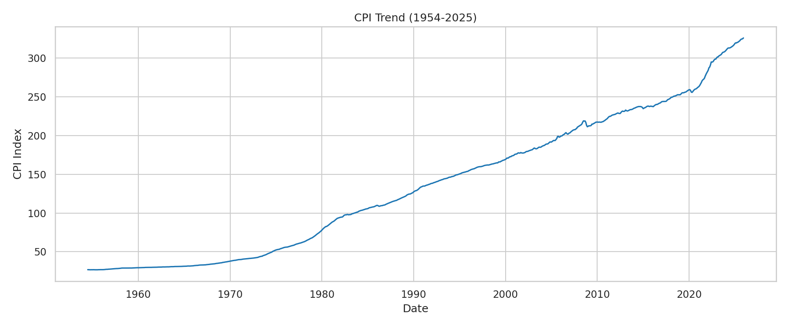
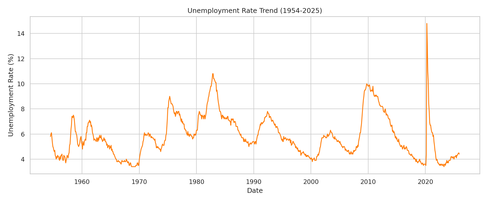
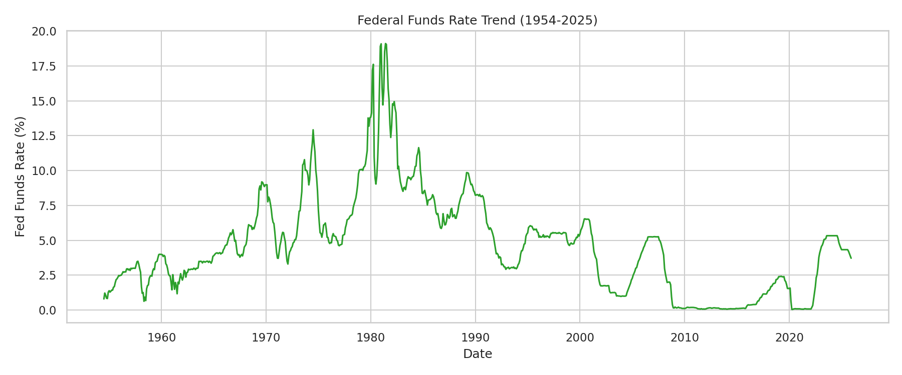
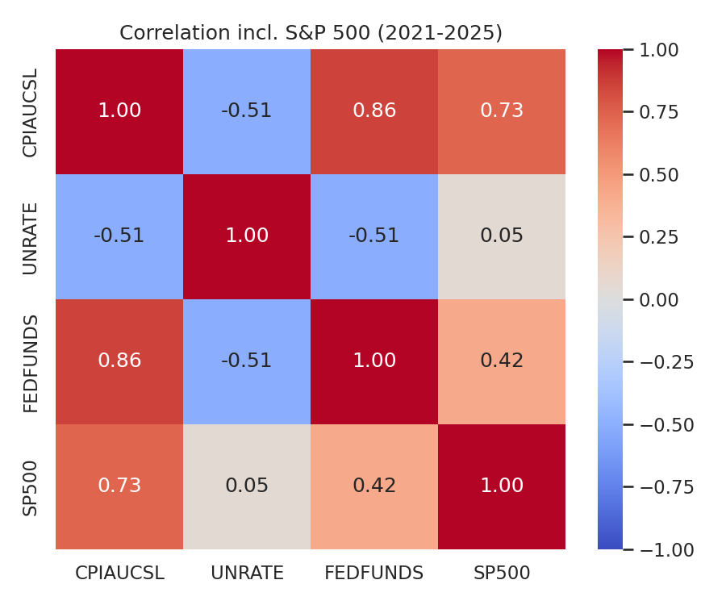
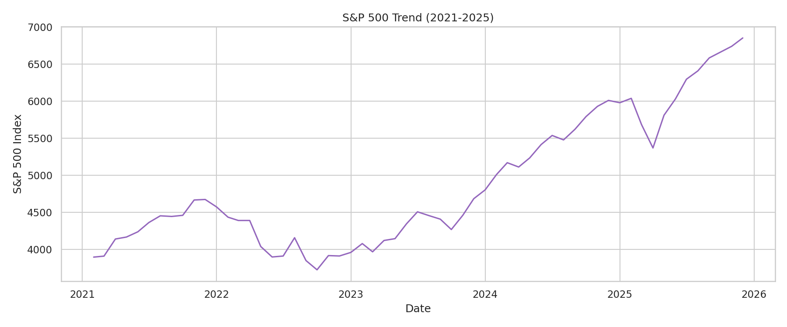
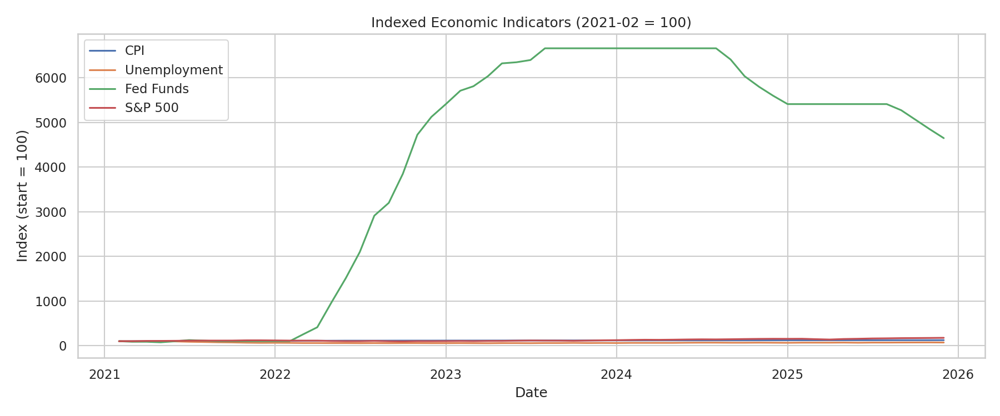
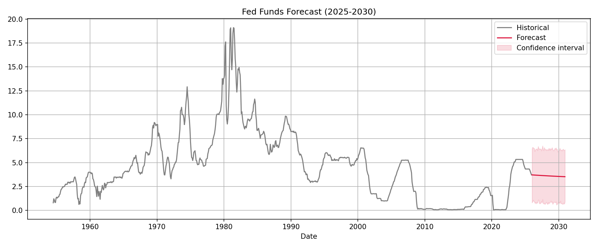
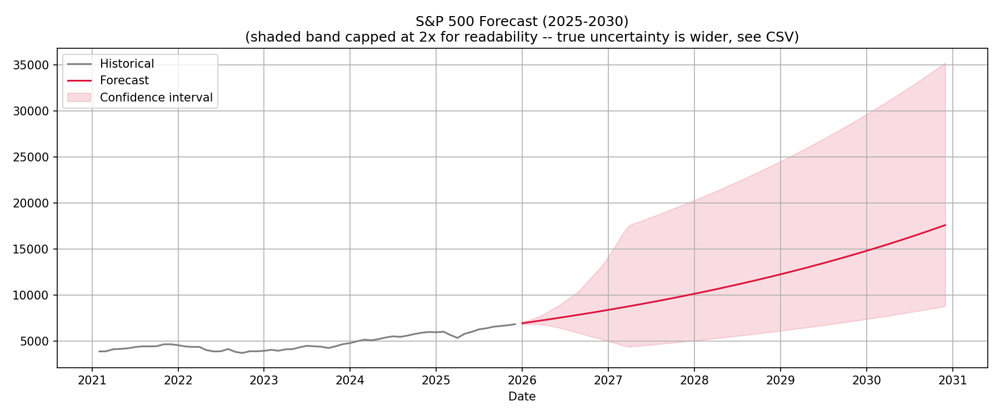

**<div align="center">

# 📈 Market & Economic Analytics

**70 years of US macroeconomic data, financial markets, and an honest look at how well Prophet can forecast them.**

<p align="center">
  
  
  
  
  
  
  
  
</p>

<p align="center">
  <a href="https://fred.stlouisfed.org/">
    
  </a>
</p>

[Overview](#overview) · [Key Findings](#key-findings) · [Visual Tour](#visual-tour) · [Forecasting](#forecasting) · [Quick Start](#quick-start) · [Limitations](#limitations)

</div>

---

<a id="overview"></a>

## 🔍 Overview

How do inflation, unemployment, interest rates and stock markets move together, and can a time-series model predict where they go next?

This project analyses **CPI, the unemployment rate, the Federal Funds Rate and the S&P 500** using data from [FRED](https://fred.stlouisfed.org/). It covers the full workflow: cleaning, exploratory analysis, correlation analysis, five-year Prophet forecasts, and a candid evaluation of where those forecasts break down (notably around the 2021–2023 inflation shock).

| | |
|---|---|
| **Period** | 1954–2025 (macro indicators), 2021–2025 (with S&P 500) |
| **Indicators** | CPI · Unemployment · Fed Funds Rate · S&P 500 |
| **Methods** | EDA, correlation analysis, Prophet forecasting |
| **Evaluation** | MAE and RMSE on a 5-year holdout |
| **Stack** | Python, Pandas, NumPy, scikit-learn, Prophet, Matplotlib, Seaborn |

<a id="key-findings"></a>

## 🎯 Key Findings

> ✏️ **Fill these in from your notebooks.** A README that states results gets read; one that only describes method doesn't. Examples of the format are shown below, so replace the bracketed parts with your real numbers.

- **Inflation:** CPI [rose X-fold between 1954 and 2025]; the sharpest acceleration was [period], with year-on-year inflation peaking near [X%] in [month/year].
- **Monetary policy:** The Fed Funds Rate peaked at [X%] in [year] and [describe 2021–2023 tightening cycle].
- **Correlations:** In the long-term data, [pair] showed [strong/weak, positive/negative] correlation (r = [X]). In 2021–2025, the S&P 500 correlated [r = X] with [indicator], a relationship that [did / did not] hold in the long-run data.
- **Forecast accuracy:** The CPI model performed [best/worst] (see [results](#model-evaluation)), while the S&P 500 forecast had the widest uncertainty because of its short training history.

## 🗂️ Data

Source: [Federal Reserve Economic Data (FRED)](https://fred.stlouisfed.org/)

| Indicator | FRED Series | Measures | Original source |
|---|---|---|---|
| Consumer Price Index | [`CPIAUCSL`](https://fred.stlouisfed.org/series/CPIAUCSL) | Consumer price level | U.S. Bureau of Labor Statistics |
| Unemployment Rate | [`UNRATE`](https://fred.stlouisfed.org/series/UNRATE) | % of labour force unemployed | U.S. Bureau of Labor Statistics |
| Federal Funds Rate | [`FEDFUNDS`](https://fred.stlouisfed.org/series/FEDFUNDS) | Effective federal funds rate | Board of Governors of the Federal Reserve System |
| S&P 500 | [`SP500`](https://fred.stlouisfed.org/series/SP500) | US equity market index | S&P Dow Jones Indices LLC |

FRED, maintained by the Federal Reserve Bank of St. Louis, aggregates and distributes these series; it does not produce them.

**Why two datasets?** The FRED `SP500` series only has a short history. Merging everything on a common date range would have thrown away decades of macro data, so the project keeps two datasets:

| File | Coverage | Used for |
|---|---|---|
| `macro_long_history.csv` | 1954–2025 | Long-run CPI, unemployment and Fed Funds analysis |
| `master_monthly_dataset.csv` | 2021–2025 | Cross-indicator analysis including the S&P 500 |

<a id="visual-tour"></a>

## 🖼️ Visual Tour

### Long-run trends (1954–2025)

| CPI | Unemployment | Federal Funds Rate |
|:---:|:---:|:---:|
|  |  |  |

### Correlation analysis

| Long-term (1954–2025) | Recent, incl. S&P 500 (2021–2025) |
|:---:|:---:|
|  |  |

> Correlation is not causation, and results are sensitive to the period chosen. The two heatmaps are deliberately shown side by side to illustrate that.

### Recent market behaviour (2021–2025)

| S&P 500 trend | Indexed indicators (common base) |
|:---:|:---:|
|  |  |

<a id="forecasting"></a>

## 🔮 Forecasting

Each series gets a Prophet configuration suited to its behaviour, rather than one-size-fits-all settings.

| Indicator | Approach | Rationale |
|---|---|---|
| CPI | Linear trend on **log-transformed** CPI | Price levels grow roughly exponentially |
| Fed Funds Rate | **Logistic growth** with bounded limits | Policy rates are cyclical and cannot go below a floor |
| S&P 500 | Linear trend on **log-transformed** index | Works with the shorter available history |

All models produce a **five-year forecast** with uncertainty intervals.

| CPI | Fed Funds Rate | S&P 500 |
|:---:|:---:|:---:|
|  |  |  |

> ⚠️ **The S&P 500 forecast is the least reliable.** With limited training data, its long-horizon intervals are very wide and should not be read as an estimate of future market performance.

<a id="model-evaluation"></a>

## 📏 Model Evaluation

Models are scored on a holdout period matching the five-year forecast horizon using:

- **MAE** (Mean Absolute Error): average size of the miss
- **RMSE** (Root Mean Squared Error): like MAE but penalises large misses more

| Indicator | Holdout period | MAE | RMSE |
|---|---|---|---|
| CPI | [1954–2025 (n = 857)] | [24.70 ] | [ 27.16] |
| Federal Funds Rate | [1954–2025 (n = 857)] | [2.98 ] | [3.54 ] |
| S&P 500 | [2021–2025 (n = 58)] | [189.01 ] | [ 273.32] |

> ✏️ Copy these from [`reports/model_accuracy.txt`](reports/model_accuracy.txt) so readers don't have to open another file.

**Context:** the evaluation period spans the 2021–2023 inflation shock and monetary policy changes, which makes forecasting harder. See `reports/model_accuracy.txt` for the actual scores.

### Modelling lessons

- **Trend continuity:** forecasts should join the historical series without artificial jumps.
- **Clean evaluation:** training and test periods must be strictly separated to avoid inflated scores.
- **Bounded series:** interest rates need logistic (capped) growth rather than unrestricted extrapolation.
- **Uncertainty matters:** wider intervals are information, not a flaw.
- **Regime change:** relationships between indicators are not stable over time.

<a id="quick-start"></a>

## 🚀 Quick Start

**Requirements:** Python 3.9+, Git. Prophet can be the fussiest dependency to install. If `pip` fails, see the [Prophet install guide](https://facebook.github.io/prophet/docs/installation.html).

```bash
# 1. Clone
git clone https://github.com/UjjawalKr-01/market-economic-analytics.git
cd market-economic-analytics

# 2. Create and activate a virtual environment
python -m venv venv
source venv/bin/activate        # macOS / Linux
venv\Scripts\activate           # Windows

# 3. Install dependencies
pip install -r requirements.txt

# 4. Launch Jupyter
jupyter notebook
```

Then run the notebooks **in order**, since each one depends on the outputs of the previous:

| # | Notebook | What it does |
|---|---|---|
| 1 | [`01_data_loading_cleaning.ipynb`](notebook/01_data_loading_cleaning.ipynb) | Loads FRED data, cleans it, builds both datasets |
| 2 | [`02_eda.ipynb`](notebook/02_eda.ipynb) | Trends, correlations, indexed comparisons |
| 3 | [`03_predictive_modelling.ipynb`](notebook/03_predictive_modelling.ipynb) | Prophet models, forecasts, MAE/RMSE evaluation |

## 📁 Repository Structure

```text
market-economic-analytics/
├── Data/
│   ├── raw/             # Original FRED downloads
│   └── processed/       # Cleaned datasets and forecast outputs
├── models/              # Saved Prophet models (.pkl)
├── notebook/            # 01 → 02 → 03, run in order
├── reports/             # model_accuracy.txt, correlation outputs
├── visuals/             # Exported charts (.png)
├── requirements.txt
└── README.md
```

<a id="limitations"></a>

## ⚠️ Limitations

- **Historical dependency:** models learn from the past and cannot foresee unprecedented events.
- **Structural change:** economic relationships shift between monetary and economic regimes.
- **Short S&P 500 history:** limits both training and evaluation.
- **Policy uncertainty:** the Fed Funds Rate depends on human decisions, not just trends.
- **Horizon effect:** uncertainty grows the further ahead you forecast.

These forecasts are **model-based estimates, not predictions or financial advice**.

## 🛣️ Future Work

> None of the items below are implemented in the current version of this project. They are ideas for possible extensions.

- Compare Prophet with alternative time-series forecasting techniques
- Introduce rolling-window and walk-forward validation
- Investigate economic relationships across different historical regimes
- Expand to additional international economic indicators and other financial or macroeconomic datasets
- Develop an interactive dashboard for exploring indicators and forecasts

## 🧰 Skills Demonstrated

Data cleaning & preprocessing · Exploratory data analysis · Correlation analysis · Time-series forecasting · Model evaluation (MAE, RMSE) · Data visualisation · Macroeconomic analysis

## 👤 Author

**Ujjawal Kumar** · [@UjjawalKr-01](https://github.com/UjjawalKr-01)

Feedback and suggestions are welcome via [issues](https://github.com/UjjawalKr-01/market-economic-analytics/issues).

## 📄 License & Acknowledgements

<!-- Add a LICENSE file (MIT is a common choice) and update this line. -->
Data retrieved from [FRED](https://fred.stlouisfed.org/), maintained by the Federal Reserve Bank of St. Louis. Underlying series are produced by the U.S. Bureau of Labor Statistics, the Federal Reserve Board and S&P Dow Jones Indices. Forecasting built with [Prophet](https://facebook.github.io/prophet/).**
